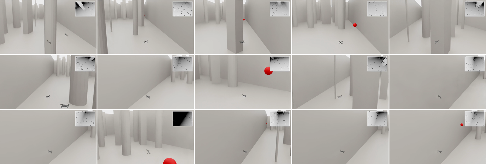

# isaac-rl: a quadrotor that flies through clutter from depth alone

A Crazyflie-sized quadrotor learns, entirely in simulation (NVIDIA Isaac Sim / Isaac Lab), to fly to a goal 20–24 m
away through a randomized field of cylinders, boxes, thin poles and walls with doors, using only a 64 × 48 depth
camera and its own motion sensors. All training ran on rented GPUs (NVIDIA Brev), launched from a laptop.

**Result:** on obstacle maps it has never seen (difficulty 5 of 10), the depth-only policy reaches the goal in
**94.5% ± 0.7** of episodes (3 seeds; PLAN.md's target, G3, was ≥ 85%). A version trained under domain randomization
(mass, thrust, motor lag, latency, wind, sensor noise) keeps **82–84%** when all of those are randomized at once,
where the unrandomized policy falls to 54%.

Checkpoints and the model card: [Hugging Face](https://huggingface.co/vedssharma/isaac-rl-drone-nav). Training curves and the benchmark per run: the
[W&B report](https://forge.coreweave.com/vedssharma1/isaac-rl/reports/isaac-rl:-a-quadrotor-that-flies-through-clutter-from-depth-alone--VmlldzoxODM2NDEwMQ==) (on the project's W&B server). See [PLAN.md](PLAN.md) for the original plan and goals, and the
phase notes below for everything that happened.



*The Phase 4 policy on held-out level-5 maps, one frame every 2 s. Top right: the 64 × 48 depth image the policy
sees (near = bright). The same under full randomization: [p5-final-l5-randomized.png](docs/images/p5-final-l5-randomized.png).
The videos and how they were made: [Phase 5 §2](docs/phase5-writeup.md).*

## How it works

The hard problem, flying through clutter from pixels, is split into steps, each building on the last:

1. **Fly to a goal** ([Phase 1](docs/phase1-goal-env.md)). A custom Isaac Lab task (`Drone-Nav-Goal-v0`) with
   collective-thrust + body-rate actions tracked by a rate controller, trained with PPO (RSL-RL).
2. **A privileged teacher** ([Phase 2](docs/phase2-obstacles.md)). Procedural obstacle corridors with a 10-level
   curriculum (`Drone-Nav-Obstacles-v0`). The teacher "cheats": it sees a 360° ray-cast lidar ring and the exact
   positions of the 4 nearest obstacles.
3. **A depth student** ([Phase 3](docs/phase3-depth-student.md)). `Drone-Nav-Depth-v0` adds a forward ray-cast depth
   camera with a stereo-like noise model (checked against exact geometry on 99.97% of pixels). A CNN + GRU student is
   trained to imitate the frozen teacher with DAgger. Two things made it work: a teacher that *faces where it flies*
   (the first teacher flew tail-first, so the camera never saw what it reacted to: 3.6% → 94%), and memory (a GRU)
   for doors that leave the field of view.
4. **Robustness** ([Phase 4](docs/phase4-robustness.md)). Domain randomization of mass, inertia, thrust, motor lag,
   drag, latency, wind and noise; the teacher is fine-tuned under it and the student re-distilled.
5. **Benchmark and write-up** ([Phase 5](docs/phase5-writeup.md), this page and [docs/benchmark.md](docs/benchmark.md)).

## Benchmark

Success rate (%) on held-out maps (60 layouts per level never used in training, 1000 episodes per cell and seed),
mean over 3 seeds ± 95% CI. "L5 randomized": level 5 with every Phase 4 randomization on at once.

| Policy | L1 | L3 | L5 | L7 | L9 | L5 randomized |
|---|---:|---:|---:|---:|---:|---:|
| Teacher (privileged: lidar + nearest obstacles) | 98.6 ± 2.1 | 97.1 ± 1.0 | 93.4 ± 2.5 | 81.4 ± 5.0 | 58.1 ± 15.5 | 50.8 ± 8.6 |
| Depth student, feed-forward | 95.5 ± 15.0 | 97.6 ± 1.2 | 92.9 ± 6.3 | 88.2 ± 8.1 | 69.5 ± 31.1 | 41.7 ± 28.9 |
| **Depth student, GRU** (Phase 3) | **99.7 ± 0.5** | **98.4 ± 0.7** | **94.5 ± 0.7** | 87.8 ± 4.4 | 70.4 ± 9.7 | 54.2 ± 18.9 |
| **Depth student, GRU, randomized** (Phase 4) | 99.0 ± 2.5 | 97.8 ± 2.4 | 92.9 ± 3.5 | 84.5 ± 4.7 | 61.2 ± 25.5 | **81.9 ± 16.9** |

Collision rates and the W&B runs behind each row are in [docs/benchmark.md](docs/benchmark.md). With 3 seeds the
intervals mostly show seed-to-seed spread: for example the feed-forward student's L1 is low because one seed climbs
out of the arena in 11% of episodes, a habit it copied from its teacher.

What the numbers say:

- **The depth students match their privileged teacher** at levels 1–5 and beat it at 7–9, although they see 90°
  ahead instead of 360° around. A plausible reason, not tested: imitation averages away some of the teacher's
  riskier moves.
- **Memory makes the student consistent:** the GRU student's spread at level 5 is ± 0.7 against ± 6.3 without it.
- **Training under randomization is what buys robustness** (54% → 82% under full randomization), at a cost of
  1–2 points nominally.
- **Level 9 (0.6 m gaps, 12 obstacles per 100 m²) is not solved** by any policy, and **thin poles (3–6 cm)** remain
  the main cause of collisions everywhere: they are only 1–3 pixels wide in the depth image a second before impact.

## Lessons

- **A privileged teacher must be imitable from the student's viewpoint.** The first teacher's 360° sensing let it fly
  backwards; its student, with a forward camera, scored 3.6%. A heading term in the teacher's reward fixed it
  ([Phase 3 §4–6](docs/phase3-depth-student.md)). Students inherit their teacher's habits seed by seed (climbing,
  stalling at walls), so most student problems were teacher problems.
- **Measure before tuning.** A lidar replay, near-miss geometry, failure recordings with the depth images of the last
  2 s, and a per-pixel check of the camera against exact geometry each changed what was worked on next
  ([Phase 2 §11–15](docs/phase2-obstacles.md), [Phase 3 §2, §8](docs/phase3-depth-student.md)).
- **Domain randomization from scratch failed; fine-tuning under it worked**
  ([Phase 4 §3–4](docs/phase4-robustness.md)).
- **Relative metrics can mislead.** A stronger-wind variant halved the "drop under randomization" mostly by getting
  worse in calm air ([Phase 4 §6](docs/phase4-robustness.md)).

## Reproducing

Setup (accounts, keys, the Brev CLI): [docs/setup.md](docs/setup.md). Everything runs through
[scripts/brev/launch.py](scripts/brev/launch.py), which creates a GPU instance, runs a pushed commit, verifies the
checkpoint on W&B and Hugging Face, and deletes the instance. The Phase 4 policy, for example:

```bash
# Teacher: Phase 3's (heading + soft-ceiling terms, 4 nearest obstacles), fine-tuned under randomization
python scripts/brev/launch.py --run-name p4-teacher-dr-ft-s42 -- --task Drone-Nav-Obstacles-v0 --num_envs 4096 \
  --seed 42 --max_iterations 1000 --init_wandb_run <nominal teacher run> env.slow_distance=1.0 \
  env.near_speed_limit=1.5 env.collision_radius=0.15 env.nearest_obstacles_obs=4 env.rewards.heading=1.0 \
  env.rewards.altitude=2.0 env.randomization.mass_spread=0.2 ...   # docs/phase4-robustness.md §1
# Student: GRU, distilled with DAgger under the same randomization
python scripts/brev/launch.py --run-name p4-distill-gru-dr-s42 --script distill -- --task Drone-Nav-Depth-v0 \
  --num_envs 4096 --max_iterations 500 --num_steps_per_env 48 --num_minibatches 8 --gru_hidden 256 \
  --teacher_run <teacher run> env.randomization.mass_spread=0.2 ... env.depth_noise_scale=2.0
# Evaluation on held-out maps, and the benchmark table
python scripts/brev/launch.py --run-name p4-eval --script play -- --task Drone-Nav-Depth-v0 --wandb_run <run> \
  --episodes 2000 --num_envs 1024 env.eval_terrain_level=5 env.terrain.terrain_generator.seed=1001
python scripts/benchmark_table.py
```

CPU tests (map generation, rewards, sensors, the student and DAgger pieces, the launcher): `pytest` (164 tests).

## Layout

```
source/drone_nav/drone_nav/   Isaac Lab extension
  tasks/goal, obstacles, depth   the three tasks (Drone-Nav-Goal/-Obstacles/-Depth-v0)
  terrain/obstacle_field.py      procedural obstacle maps, layouts, lidar and camera replays
  sensors/depth.py               pinhole geometry and the depth noise model
  policies/depth_student.py      the CNN (+ GRU) student and DAgger helpers
  mdp/                           rewards, randomization, curriculum, geometry
scripts/                      train.py, distill.py, play.py, check_depth.py, benchmark_table.py, plot_failures.py,
                              compose_video.py; brev/ launch.py and reap.py
docs/                         one note per phase, the benchmark, setup
```

## Cost

About 130 launches on rented L40S GPUs (Nebius, Crusoe; $1.74–2.18 per hour), roughly **$140** in all: $105 recorded
by the launcher plus boxes that ran unrecorded (one orphaned for 15 hours when a session ended mid-run). Phases 2–4
took nearly all of it.

## Progress notes

- [Phase 0: our own `train.py` and the first drone videos](docs/phase0-train-wrapper-and-video.md)
- [Phase 1: `Drone-Nav-Goal-v0`](docs/phase1-goal-env.md): 100% success on goals 10–20 m away
- [Phase 2: obstacles and the privileged teacher](docs/phase2-obstacles.md)
- [Phase 3: the depth student](docs/phase3-depth-student.md)
- [Phase 4: robustness](docs/phase4-robustness.md)
- [Phase 5: the benchmark and write-up videos](docs/phase5-writeup.md); the table: [benchmark.md](docs/benchmark.md)
