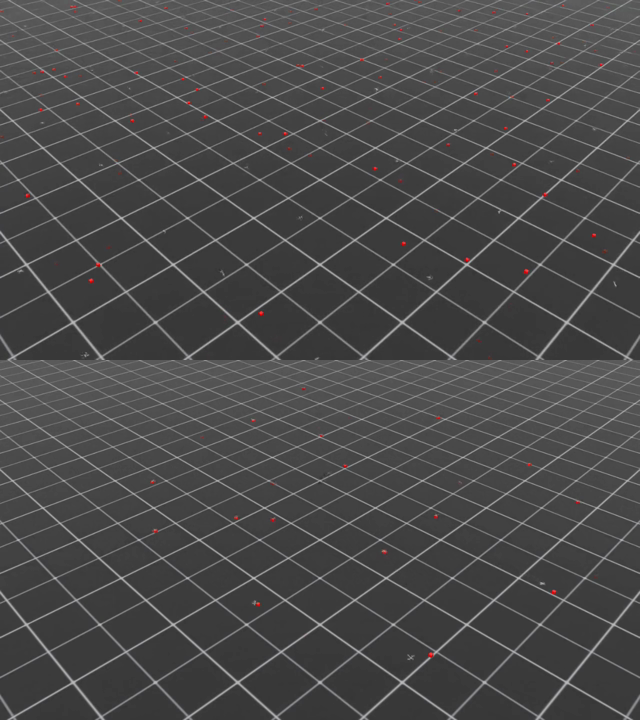

# Phase 0 wrap-up: our own `train.py` and the first drone videos

*2026-11-12. Covers the work on branch `feat/train-wrapper`.*

This note records what was built, how it was tested, what went wrong on the way, and what the first
recorded videos of the trained quadcopter look like. It closes two open Phase 0 items from
[PLAN.md](../PLAN.md) §6: getting W&B logging to work reliably, and keeping checkpoints after the
instance is gone.

## TL;DR

- **New entry point:** [`scripts/train.py`](../scripts/train.py) replaces Isaac Lab's own RSL-RL training
  script for every run in this repo. W&B runs now end as **finished**, with the final checkpoint uploaded.
  Every run also records a reproducibility manifest, uploads its final checkpoint and videos to the
  Hugging Face model repo, and exits non-zero when it fails.
- **Tested on a real GPU:** a full 200-iteration run of `Isaac-Quadcopter-Direct-v0` with video recording,
  on a new Brev L40S box (`isaac-rl-video`).
  - [W&B run](https://forge.coreweave.com/wandb/vedssharma1/isaac-rl/runs/xl454j3d)
  - [HF folder](https://huggingface.co/vedssharma/isaac-rl-drone-nav/tree/main/runs/quadcopter_direct/2026-11-13_03-45-36_p0-quadcopter-video-s42)
- **Videos:** three clips from during training and one 10-second clip of the final policy. They're on W&B and HF
  (and locally in the git-ignored `videos/` folder).
- **Result:** the policy reaches its goal in every episode and never crashes, ending on average 1.7 cm
  from the goal.



*Top: env step 0 of training, the random initial policy. Bottom: the final policy. The drones are the small
grey X's and the red dots are their goals. The default camera is far away; see §5.*

## 1. Why we needed our own `train.py`

The Phase 0 baseline (`p0-quadcopter-baseline-s42`, 2026-11-12) used Isaac Lab's
`scripts/reinforcement_learning/rsl_rl/train.py`, and it trained fine. The tooling around it had four problems:

1. **W&B runs never finished.** Isaac Sim's Kit runtime hard-exits the process on
   `simulation_app.close()`. That killed the W&B background uploader before `wandb.finish()` ever ran. The runs
   stayed "running"/"crashed", lost their last metric rows, and lost the final `model_199.pt`, which then
   had to be repaired by hand with `wandb sync` and a resumed run.
2. **The W&B settings had different names.** RSL-RL reads the W&B entity from `WANDB_USERNAME` and the project from a
   CLI flag. Our `.env` uses `WANDB_ENTITY` / `WANDB_PROJECT`.
3. **Nothing went to Hugging Face.** PLAN.md §3.2 says checkpoints must outlive the instance, but the
   only copy was on W&B.
4. **Not enough was recorded to reproduce a run.** PLAN.md §7 wants every run identified by git SHA + config + seed +
   versions. The upstream script stored a git diff of Isaac Lab, not of this repo.

## 2. What `scripts/train.py` does

It's the Isaac Lab v2.3.2 script (BSD-3-Clause) with these changes:

| Change | How |
|---|---|
| Finish W&B before Kit exits | After `runner.learn()`, a `try/finally` calls `wandb.finish(exit_code=…)` and closes the TensorBoard writer, *before* `env.close()` and `simulation_app.close()`. A crash during training marks the W&B run as failed instead of leaving it "running". |
| `.env` variable names | `WANDB_ENTITY` is copied to `WANDB_USERNAME` for RSL-RL. `WANDB_PROJECT` is used when `--log_project_name` isn't given. Otherwise RSL-RL falls back to its default project, `isaaclab`. |
| Run manifest | `params/run_meta.yaml` and W&B config key `run_meta` hold: this repo's git SHA, branch and uncommitted-changes flag; versions of isaacsim, isaaclab, isaaclab_rl, isaaclab_tasks, rsl-rl-lib, torch and wandb; task, seed, num_envs, max_iterations, GPU, hostname and the full command line. The W&B logger is created *before* training starts, so the manifest is in W&B even if training crashes. |
| Hugging Face upload | After a successful run: the final checkpoint, `params/`, `git/*.diff` and any `--video` clips go to `HF_REPO_ID` at `runs/<experiment>/<timestamp>_<run_name>/`. A missing token or a failed upload prints a warning and never fails the run. `--hf_upload none` turns it off. |
| Videos on W&B | RSL-RL doesn't log videos. Finished `--video` clips are logged as `Video/train/rl-video-step-<N>`. |
| Logs location | `logs/rsl_rl/<experiment>/<timestamp>_<run_name>/` inside this repo (already git-ignored), whatever the working directory. |
| Exit codes | An exception or a Hydra error exits with its code via `os._exit`, skipping Kit's shutdown, so a future `launch.py` can tell failure from success. |
| Unbuffered output | `stdout`/`stderr` are line-buffered, so Kit's hard exit can't drop the last lines of a log file. |

[`scripts/cli_args.py`](../scripts/cli_args.py) is Isaac Lab's argument helper, copied unchanged because
`train.py` imports it. Re-copy it when the pinned Isaac Lab version changes.

[`scripts/brev/install_isaac.sh`](../scripts/brev/install_isaac.sh) now suggests `scripts/train.py` for the
full run. A new "Training runs" section in [`docs/setup.md`](setup.md) explains it.

Usage on a box:

```bash
source ~/isaac-venv/bin/activate
export PYTHONUNBUFFERED=1 ACCEPT_EULA=Y OMNI_KIT_ACCEPT_EULA=YES
export WANDB_API_KEY=… WANDB_ENTITY=vedssharma1 WANDB_PROJECT=isaac-rl \
       WANDB_BASE_URL=https://api.forge.coreweave.com HF_TOKEN=… HF_REPO_ID=vedssharma/isaac-rl-drone-nav
python scripts/train.py --task Isaac-Quadcopter-Direct-v0 --headless --num_envs 4096 \
    --seed 42 --run_name p0-quadcopter-video-s42 --logger wandb \
    --video --video_length 400 --video_interval 2000
```

## 3. How it was tested

### 3.1 Locally, without a GPU

Isaac Sim can't run on the laptop, so a check script loaded `train.py` with Isaac Sim, Isaac Lab, torch and
RSL-RL replaced by stubs. It then exercised the helpers:

- The `.env` names map correctly, and an explicit `--log_project_name` wins.
- `collect_run_meta` returns this repo's SHA and branch.
- The HF upload is skipped when the token is missing, builds the right `path_in_repo` and file patterns, and
  survives an upload error without raising.
- `finish_logging` finishes a real (offline) W&B run, logs a video, and closes the writer.

`ruff` passes. The usual late-import warning (E402) is expected, because Kit must start before Isaac Lab
imports.

### 3.2 On a GPU box

Three things were run on the box, in order:

| Step | Command | Result |
|---|---|---|
| Train with video | `scripts/train.py … --video` (200 iterations, 4096 envs) | Exit 0. The W&B run is **finished** and has `model_0/50/100/150/199.pt`, three videos and `run_meta`. HF has `model_199.pt`, `params/`, `git/isaac-rl.diff` and the three training clips. |
| Final-policy video | Isaac Lab `play.py --checkpoint …/model_199.pt --num_envs 16 --video --video_length 500` | Exit 0, a 10 s clip at 1280×720, 50 fps |
| Failure path | `scripts/train.py --task Does-Not-Exist-v0` | Exit **1**, failing with gymnasium's "Environment `Does-Not-Exist` doesn't exist" |

One change came *after* the GPU run. The git lookup for the Isaac Lab checkout was removed (see §4.4). That
version was re-checked locally, but not on the GPU.

## 4. What happened along the way

### 4.1 No L40S capacity for the dev box

`brev start isaac-rl-dev` (AWS `g6e.xlarge`) was accepted, but the instance stayed `STOPPED` for about 1.5 hours.
AWS had no free L40S in that region. This is the restart risk PLAN.md §3.2 warns about. The pending start was
cancelled with `brev stop`, so the box couldn't start later with no one watching.

### 4.2 A new box on Nebius

`brev search` listed RT-core GPUs from several providers. RT cores are needed for rendering video (PLAN.md
§3.1). `brev create` accepts a fallback list of instance types:

```bash
brev create isaac-rl-video \
  --type gpu-l40s-d.1gpu-16vcpu-96gb,g6e.2xlarge,g6.2xlarge,g2-standard-8:nvidia-l4:1,g5.2xlarge
```

The first choice worked: a **Nebius L40S, 16 vCPU, 96 GB RAM, 116 GB disk, $2.18/h**, ready in about 3
minutes. `install_isaac.sh` ran unchanged and finished in **about 5 minutes**, much faster than on the 4-vCPU
AWS box.

Install note: the `./isaaclab.sh --install rsl_rl` step logs
`Failed to build flatdict==4.0.1 … No module named 'pkg_resources'` when it tries to reinstall
`source/isaaclab` as an editable package. It's harmless here: the `isaaclab` pip wheel (with `flatdict
4.0.0`) stays in place, and `isaaclab_rl` / `isaaclab_tasks` install fine. It's worth knowing when reading
install logs, and fixing it when the Dockerfile is written.

### 4.3 Isaac Sim's license prompt

The first launch on the new box died immediately with `Do you accept the EULA? (Yes/No): … EOF when reading a
line`. `install_isaac.sh` exports `ACCEPT_EULA=Y OMNI_KIT_ACCEPT_EULA=YES`, but only inside its own
process. Every later run must export them too. They're now in the usage example above.

### 4.4 Isaac Lab's git info isn't recoverable inside Kit

`train.py` originally also recorded the Isaac Lab checkout's `git describe` and diff, by looking up where
`isaaclab_tasks` was installed. That works in plain Python, where `isaaclab_tasks` resolves to the editable
checkout. **Inside Kit, though, `isaaclab_tasks` loads from the copy bundled in the `isaaclab` wheel**
(`site-packages/isaaclab/source/isaaclab_tasks/`). That copy has no git repo, so the lookup always came back
empty. The lookup was removed. The package versions in `run_meta` (`isaaclab 2.3.2.post1`,
`isaaclab_tasks 0.11.12`) are the real record of which Isaac Lab code ran. The checkout is only used for
Isaac Lab's `play.py`.

### 4.5 The first playback picked the wrong checkpoint

The ad-hoc run script picked "the latest checkpoint" with `sort -t_ -k2 -n` on the full path. The directory
names contain underscores (`rsl_rl`, `quadcopter_direct`), so it sorted on the wrong field and chose
`model_50.pt`. That playback was stopped and re-recorded from `model_199.pt`. The final script `play.py` (Phase 1)
should take the checkpoint from the W&B summary's `final_checkpoint` rather than guess.

### 4.6 Nebius is slow to stop

`brev stop isaac-rl-video` stayed in `STOPPING` for about 11 minutes. Always confirm `STOPPED` in `brev ls`
before walking away.

## 5. Results

Run `p0-quadcopter-video-s42`: `Isaac-Quadcopter-Direct-v0`, 4096 envs, 200 PPO iterations, seed 42.

| Iteration | Mean reward | Mean episode length (of 499) | Final distance to goal | Crash terminations / iteration |
|---:|---:|---:|---:|---:|
| 0 | −17.1 | 24 | 1.73 m | 135 |
| 25 | −0.05 | 24 | 1.82 m | 168 |
| 50 | 3.5 | 84 | 1.98 m | 23 |
| 100 | 116.5 | 499 | 0.09 m | 0 |
| 150 | 131.9 | 499 | 0.018 m | 0 |
| 199 | 133.2 | 499 | 0.017 m | 0 |

The policy first learns not to crash, between iterations 25 and 100. Then it learns to settle precisely on
the goal (9 cm down to 1.7 cm). The final numbers match the earlier baseline run (reward 132.8, 1.4 cm), so
the new script doesn't change training.

**Throughput.** The median was about **390k env-steps/s**, against about 296k for the baseline on the 4-vCPU AWS
box. It drops to about 17k steps/s during the iterations where a video clip is being recorded. Training took
106 s with video, against 68 s without.

**The videos.** On W&B, HF, and locally in `videos/p0-quadcopter-video-s42/`:

| File | Training stage | What the metrics say at that point |
|---|---|---|
| `train-step-0.mp4` | The random initial policy (iteration 0) | Episodes last about 24 of 499 steps. Almost every drone crashes. |
| `train-step-2000.mp4` | About iteration 83 | Between iterations 50 and 100, crashes fall from 23 to 0 per iteration and episodes stretch to the full length. Distance to the goal is only starting to shrink. |
| `train-step-4000.mp4` | About iteration 167 | No crashes, and drones end within about 2 cm of their goal. |
| `play-final-policy-model_199.mp4` | The final policy, 16 drones, 10 s | Same as above: drones fly to their red goal markers and hold position. |

Isaac Lab's default viewer camera is far away and covers thousands of envs, so the 3-cm Crazyflies are
small grey X's, and most of their motion is hard to see at this scale. **A closer chase camera that follows
one drone is the first thing to add** in Phase 1's own `play.py`.

**Cost.** The video box was up for about 25 minutes, including the 11-minute stop, roughly **$0.90**. While stopped, its disk is billed at
$0.12/GB/month, about $14/month for 116 GB. Delete it (`brev delete isaac-rl-video`) if the dev box comes back.

## 6. Next steps

1. **Merge this branch**, and use `scripts/train.py` for all runs from now on.
2. **Pick a dev box.** Keep `isaac-rl-video` (Nebius, starts fast, installs fast) as the dev box and delete the
   AWS one, or the other way round. Paying for both disks isn't worth it.
3. **Measure throughput at 1k / 4k / 8k envs.** This is the last unchecked Phase 0 measurement.
4. **Phase 1:** scaffold `source/drone_nav` with `Drone-Nav-Goal-v0`. Add goals 10–20 m away, a goal-reached
   termination with a success-rate metric, the progress-based reward from PLAN.md §4.3, and our own
   `play.py` with a chase camera on one drone that reads the final checkpoint from W&B.
5. **Before Phase 2 sweeps:** write the Dockerfile (fixing the `flatdict` build warning there),
   `launch.py`, and `reap.py`.
