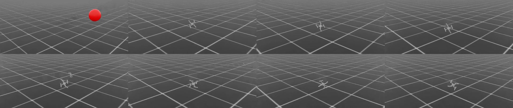

# Phase 1: our own environment, `Drone-Nav-Goal-v0`

*2026-11-13. Covers branch `feat/phase1-goal-env`.*

Phase 1 of [PLAN.md](../PLAN.md) §6: build our own Isaac Lab environment, with goal reaching and no obstacles yet, plus a
`play.py` that evaluates a checkpoint and records a video.

## TL;DR

- **New task:** `Drone-Nav-Goal-v0` in [`source/drone_nav`](../source/drone_nav), this repo's Isaac Lab extension.
  A Crazyflie flies to a goal 10–20 m away at a random heading and altitude.
- **Result:** the first run met the Phase 1 exit criterion (≥ 98% of episodes reach the goal):
  - **100% success over 1000 held-out evaluation episodes** (95% CI 99.6–100%)
  - no crashes and no time-outs
  - training took 5 minutes (500 PPO iterations, 4096 envs) and cost about $0.77 on a Brev L40S, launched with
    `scripts/brev/launch.py`
- **New [`scripts/play.py`](../scripts/play.py):**
  - loads a W&B run's final checkpoint
  - runs N deterministic episodes and reports rates with 95% confidence intervals
  - records a chase-cam video
  - writes the results to W&B (`eval/*`) and to HF next to the checkpoint
  - `launch.py --script play` runs it on a fresh box
- **Caveat:** the policy flies at about 10 m/s and reaches the goal in 1.5 s. That's legal in this sim, which has no
  aerodynamic drag, but far beyond a real Crazyflie. See §5.

## 1. The task

| | |
|---|---|
| Robot / action | Isaac Lab's Crazyflie, collective thrust + body torques in [-1, 1] (PLAN.md §4.1 v1, same scaling as `Isaac-Quadcopter-Direct-v0`) |
| Spawn | 1–1.5 m up, random yaw, random velocity (σ 0.2 m/s per axis) |
| Goal | random heading, 10–20 m away horizontally, 0.75–2.5 m altitude. Reached within 0.5 m. |
| Observation (18) | body-frame linear velocity, body rates, gravity in the body frame, last action, unit direction to the goal (body frame), goal distance clipped to 10 m and scaled to [0, 1], altitude |
| Terminations | goal reached (success), too low (< 0.1 m), too high (> 4 m), flipped, off course (> 5 m further from the goal than at the start) |
| Truncation | 20 s time limit. PPO bootstraps through it rather than treating it as a death. |
| PPO | [256, 256, 128] ELU, observation normalization, 24 steps per env per iteration, adaptive KL (PLAN.md §4.5) |

Reward (PLAN.md §4.3 without the obstacle term). Every term is logged separately as `Episode_Reward/<term>`:

| Term | Weight | Unit |
|---|---|---|
| progress | +1 | per metre closed toward the goal |
| goal | +10 | once, on success |
| crash | −10 | once, on any crash termination |
| smooth | −0.05 | per second × ‖aₜ − aₜ₋₁‖² |
| ang_rate | −0.01 | per second × ‖ω‖² |
| upright | −0.5 | per second × (1 − up_z) |
| time | −0.1 | per second |

The math lives in plain torch in [`drone_nav/mdp/goal.py`](../source/drone_nav/drone_nav/mdp/goal.py), so it runs in
CPU tests ([`tests/test_goal_mdp.py`](../tests/test_goal_mdp.py)): goal sampling ranges, the observation, every
termination case, reward signs, progress telescoping to the distance closed, and "flying to the goal beats hovering
beats crashing".

**Metrics are exact per-episode rates.** RSL-RL takes the mean over every element of each logged tensor. So the env
logs, for the episodes ending at each step, a 0/1 vector per termination reason and for `Metrics/success_rate`. It
also logs vectors for time to goal, path efficiency (distance closed ÷ distance flown), mean speed and final distance.

## 2. Training: `p1-goal-baseline-s42`

`launch.py --run-name p1-goal-baseline-s42 -- --task Drone-Nav-Goal-v0 --num_envs 4096 --seed 42 --video …`
([W&B](https://forge.coreweave.com/wandb/vedssharma1/isaac-rl/runs/l714kk2y),
[HF](https://huggingface.co/vedssharma/isaac-rl-drone-nav/tree/main/runs/drone_nav_goal/2026-11-13_20-03-37_p1-goal-baseline-s42))

| Iteration | Mean reward | Success | Flipped | Final distance | Time to goal | Mean speed |
|---:|---:|---:|---:|---:|---:|---:|
| 0 | −11.1 | 0% | 99.5% | 15.0 m | – | 0.3 m/s |
| 25 | −7.1 | 0% | 2.4% | 5.9 m | – | 3.9 m/s |
| 50 | 18.0 | 99.6% | 0% | 0.46 m | 6.4 s | 5.5 m/s |
| 100 | 22.8 | 100% | 0% | 0.37 m | 1.8 s | 8.2 m/s |
| 499 | 24.2 | 100% | 0% | 0.33 m | 1.5 s | 9.9 m/s |

1. **Iterations 0–25: learn to fly.** The random policy flips within about 10 steps, and by iteration 25 almost nothing
   crashes.
2. **Iterations 25–50: learn to reach the goal.** Success jumps from 0% to 99.6%.
3. **After iteration 50: get faster.** Time to goal drops from 6.4 s to 1.5 s, because progress per step and the time
   cost pay for speed.

**Throughput:** about 320k env-steps/s, and about 90k on iterations that record video. That's slower than the
built-in quadcopter (390k): this task has more observations and episodes reset more often. Training took 310 s, and
the launch took 21 min of box time (about $0.77), most of it install, Kit start-up and the Nebius delete.

## 3. Evaluation

`launch.py --script play -- --task Drone-Nav-Goal-v0 --wandb_run l714kk2y --episodes 1000 --video`. 256 envs, seed
12345 (training used 42), deterministic policy, each episode with the full 20 s limit.

| Metric | Value |
|---|---|
| Success (goal reached) | **100.0%** (1000/1000, 95% CI 99.6–100%) |
| Crashes (too low / too high / flipped / off course) | 0% each (95% CI 0–0.4%) |
| Time-outs | 0% |
| Time to goal | 1.48 s on average, for goals 10–20 m away |
| Mean speed | 9.9 m/s |
| Path efficiency (distance closed ÷ distance flown) | 0.994: essentially straight lines |
| Final distance to the goal centre | 0.33 m (success triggers at 0.5 m) |

The [video](https://huggingface.co/vedssharma/isaac-rl-drone-nav/tree/main/runs/drone_nav_goal/2026-11-13_20-03-37_p1-goal-baseline-s42/play)
follows env 0's drone from about 1.5 m. It flies straight and level to each goal, then the next episode starts.

*Eight frames, 0.16 s apart: env 0's drone reaches a goal (the red marker, first frame), and the next
episode starts. The attitude stays level throughout.*

## 4. What went wrong along the way

- **Isaac Lab keeps stale episode logs.** `DirectRLEnv` never clears `extras`, so on a step without resets RSL-RL
  would count the previous step's episode log again. The built-in quadcopter env has the same quirk. Our env clears
  `extras["log"]` at the start of every step.
- **Shutdown traceback.** With the viewer following the drone, Isaac Lab's viewport camera callback fired after
  `env.close()` had deleted the scene. Upstream deletes the scene first and relies on `__del__` to unsubscribe. Our
  env unsubscribes first.
- **Unreadable first videos.** All 4096 envs' goals (0.5 m spheres) filled the frame, and the camera was 3.8 m from a
  9 cm drone. Now only env 0's goal is drawn, at 0.1 m, and the camera is about 1.5 m away.
- **Brev:**
  - **AWS:** Nebius and Crusoe were out of capacity for the evaluation, so the launcher fell back to AWS
    `g6e.2xlarge` for the first time. Two problems turned up:
    - The ssh entry changes when the VM finishes building, so the launcher now reruns `brev refresh` while it waits.
    - The AWS image (driver 595) crashes Kit's RTX renderer, so videos can't be rendered there.
  - **apt:** a new box's own `apt-get` also holds the apt lists lock, so `install_isaac.sh` now waits for it and retries.
  - Details are in [docs/setup.md §7](setup.md).

## 5. Caveats and next steps

1. **Speed realism.** The policy flies at 10 m/s, with peaks well above, because nothing in the sim stops it: no drag,
   and thrust-to-weight 1.9 with instant motors. A real Crazyflie tops out at a few m/s. Before Phase 2 obstacles
   make speed dangerous, add one of these:
   - linear drag (part of the PLAN.md §5.5 randomization)
   - a speed penalty above a cap
   - a lower `thrust_to_weight`
2. **CTBR ablation** (the last Phase 1 item in PLAN.md): switch to collective thrust + body rates with a PD rate
   controller and compare against thrust + torques.
3. **More seeds.** These results are one seed. PLAN.md §7 wants 3 for any claim, so run seeds 1 and 2. Each costs
   about $0.80.
4. **Phase 2:** obstacle terrain, a ray-cast lidar ring, and a curriculum.
