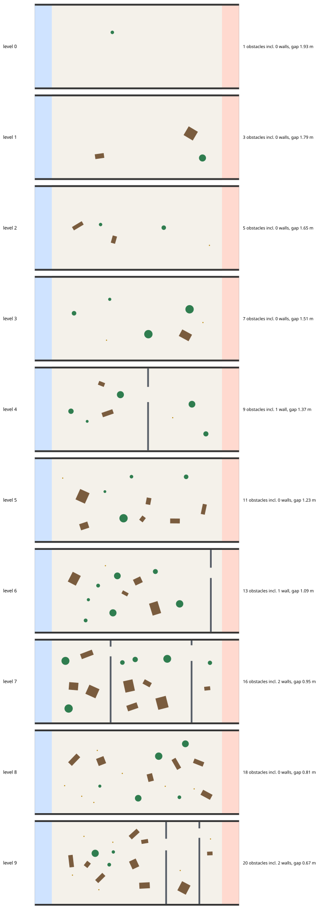

# Phase 2: obstacles with privileged sensing

PLAN.md Phase 2 builds `Drone-Nav-Obstacles-v0`: the CTBR goal-reaching task from Phase 1, through a procedural
obstacle field, with a ray-cast "lidar ring" as the observation and a curriculum over difficulty. This note
records the parts as they land.

Status:

- [x] Obstacle terrain generator and its CPU tests (§1). It has not been loaded in Isaac Sim yet; that happens with
  the env.
- [ ] `Drone-Nav-Obstacles-v0`: spawning in the start strip, lidar ring, collision termination, proximity reward
- [ ] Curriculum and held-out evaluation
- [ ] Ablations

## 1. Obstacle terrain

[`drone_nav/terrain/obstacle_field.py`](../source/drone_nav/drone_nav/terrain/obstacle_field.py) generates one tile
of Isaac Lab's terrain generator (PLAN.md §5.2 option A). Isaac Lab bakes all tiles into one static mesh, which
gives collisions through the terrain collider and fast ray casting (`RayCaster`) on any GPU.
[`obstacle_field_cfg.py`](../source/drone_nav/drone_nav/terrain/obstacle_field_cfg.py) holds the Isaac Lab configs:
`ObstacleFieldTerrainCfg` for one tile, and `OBSTACLE_FIELD_GENERATOR_CFG`, which has 10 rows of difficulty × 20
tiles each.

**A tile** is a 24 × 10 m corridor along +x with side walls. The drone starts in a 2 m strip at one end and its
goal is in a 2 m strip at the other, 20–24 m away (Phase 1 goals were 10–20 m). Obstacles fill the 18 m zone in
between, with 1 m left empty next to each strip:

- **cylinders** (trees and pillars, radius 0.15–0.5 m), **boxes** at any yaw (0.4–1.5 m sides), **thin poles**
  (3–6 cm, hard to see in depth images later), and **walls across the corridor** with one door.
- Every obstacle is a prism from the ground up to 5 m, above the env's 4 m altitude limit, so the drone has to go
  around it and can't fly over. That also turns every check into a 2-D problem about footprints.

**Difficulty** (0–1, row *i* of the curriculum is level *i*) sets three things by linear interpolation:

| | Level 0 | Level 5 | Level 9 |
|---|---:|---:|---:|
| Density (per 100 m² of obstacle zone) | 0.6 | 6.6 | 11.4 |
| Obstacles in the zone | 1 | 11 | 20 |
| Minimum gap | 1.93 m | 1.23 m | 0.67 m |
| Mix (cylinder / box / pole / wall) | 59 / 30 / 11 / 1 % | 46 / 30 / 16 / 8 % | 36 / 30 / 20 / 14 % |

Even the hardest gap is about 5× the Crazyflie's 13 cm span (PLAN.md asks for at least 2×).

*One training tile per level (seed 0). The start strip is blue and the goal strip red. Regenerate it with
`python scripts/preview_obstacle_field.py`, or `--seed 1001` for a held-out map.*

**Guarantees.** Every layout has all of these, and
[`tests/test_obstacle_field.py`](../tests/test_obstacle_field.py) checks each one on 80 layouts (8 seeds × 10
levels):

1. The start strip, the goal strip and the buffers next to them are empty.
2. Every two footprints are at least the minimum gap apart (exact distances between circles and rotated
   rectangles). Free-standing obstacles also keep that gap from the side walls, and every door is at least that
   wide.
3. A disk of radius 0.1 m (the Crazyflie plus a margin) can get from the start strip to the goal strip. The
   generator checks this with a flood fill on a 10 cm grid, and draws a new layout if it fails.
4. The collision meshes lie inside the footprints that checks 1–3 use. Cylinder meshes are 16-sided polygons
   inscribed in their circle.

Placement is random with rejection: up to 200 tries per obstacle, then that obstacle is skipped. At the default
densities, 99.98% of requested obstacles get placed, and a layout never ends up more than one short. The
density range tops out at the point where that stops being true. A tile takes about 6 ms to generate, so the
200 training tiles add about a second to start-up.

**Held-out maps.** A tile's layout depends only on the generator seed and the tile's difficulty. Training uses seed
`TRAIN_SEED = 0`, and evaluation uses `TEST_SEEDS = (1001, 1002, 1003)`, so the evaluation maps never appear in
training (PLAN.md §5.1).

**Not in this version:** horizontal bars and floating spheres (PLAN.md §5.1). Both need real 3-D checks, because
the drone could fly under or over them. Obstacles also never move; moving ones need PLAN.md §5.2 option B.
