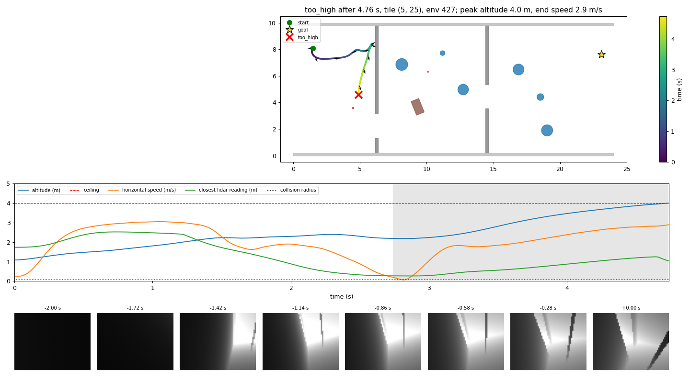
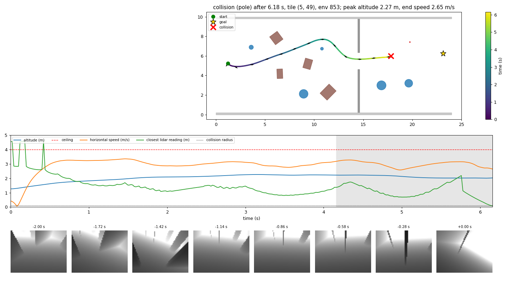

# Phase 3: a depth-based student

PLAN.md Phase 3 trains a policy that sees the obstacle field only through a forward depth camera, by distilling the
Phase 2 teacher (Option A, DAgger) and, for comparison, by PPO from depth (Option B). This note records the parts as
they land.

Status:

- [x] `Drone-Nav-Depth-v0`: a ray-cast depth camera, a noise model, and the teacher's observation alongside (§1)
- [x] The camera checked against exact geometry on 1024 drones: 99.97% of pixels agree (§2)
- [x] CNN student and `scripts/distill.py` (DAgger from the frozen teacher) (§3)
- [x] First distillation: **3.6% success** on held-out level 5. The teacher flies backwards: its direction of
  travel is inside a forward camera's view 1.9% of the time (§4)
- [x] A teacher that faces where it flies (§5): its direction of travel is in view 98.6% of the time, 89.2% / 7.05%
- [x] Distilled from it (§6): 94.4% success, 2.7% collisions on held-out level 5 from depth alone (seed 42)
- [x] **Three seeds (§6.1): 93.4% ± 2.6 success, 4.9% ± 3.9 collisions; every seed ≥ 90.5%. G3 is met.**
- [x] Its failures (§8): climbing happens at walls whose door is out of view; poles are seen but are 1–2 pixels wide
- [x] A soft ceiling in the teacher's reward (§9): climbing goes to 0. Over 3 seeds (§9.1) the teachers improve
  (93.3% against 91.2%), but the students don't: 92.5% / 6.1% against 93.4% / 4.9%, within noise
- [ ] Option B: PPO from depth with an asymmetric critic
- [x] GRU memory (§10): from the soft-ceiling teacher, **94.75% / 5.2%, time-outs 1.65% → 0.05%** against the
  feed-forward student's 91.5% / 6.35%; poles unchanged. One seed
- **Exit (G3):** ≥ 85% success at difficulty 5 from depth only.

**The teacher** (docs/phase2-obstacles.md §18): `p2-slow-margin15-nearest4-s42`
([wn2l0g9q](https://forge.coreweave.com/wandb/vedssharma1/isaac-rl/runs/wn2l0g9q), `model_1499.pt`), 93.8% / 5.65% on
the 60 held-out level-5 layouts. Its observation is the goal task's 18 inputs, the 108-ray lidar ring and the 4 nearest
obstacles (138).

## 1. The env: `Drone-Nav-Depth-v0`

`source/drone_nav/drone_nav/tasks/depth/depth_env.py` (commit `aca604d`). It's `Drone-Nav-Obstacles-v0` with the same
world, rewards, terminations and curriculum, and a different observation:

| Group | Contents | Size |
|---|---|---:|
| `policy` (the student) | the goal task's 18 inputs (body velocities, gravity, last action, goal direction and distance, altitude), then the depth image scaled to [0, 1] (1 = nothing within 6 m), row-major | 18 + 3072 = 3090 |
| `teacher` | the obstacle task's privileged observation, unchanged: goal (18), lidar ring (108), 4 nearest obstacles (12) | 138 |

The defaults are the teacher's settings (mild slowdown, `nearest_obstacles_obs=4`), so the `teacher` group is exactly
what it was trained on. The collision rule is the evaluation one, 0.1 m.

**The camera** is Isaac Lab's `RayCasterCamera`: Warp ray casts against the terrain mesh, so it needs no RT cores
(PLAN.md §3.1). It's a 64 × 48 pinhole with a 90° horizontal and 74° vertical field of view (focal length 10,
aperture 20; square pixels, 32 px focal length), on the nose 4 cm ahead of the centre, looking along the body's +x
axis. It returns distance to the image plane, capped at 6 m. Unlike the lidar ring's "yaw" alignment (Phase 2 §11),
`RayCasterCamera` applies the camera's full orientation to its rays, so the image pitches, rolls and yaws with the
drone.

**Noise** (`drone_nav/sensors/depth.py`, PLAN.md §5.4), roughly a stereo camera:

- Gaussian noise with std 0.01 m + 0.005 m × depth², which is 1.5 cm at 1 m and 19 cm at 6 m;
- 1% of pixels drop out (read max range, "no return");
- pixels on a depth edge (a jump of more than 0.3 m to a neighbour) drop out with probability 0.3, as stereo
  matching fails at occlusion boundaries;
- everything clipped to [0, 6 m].

`env.depth_noise=False` turns it off. CPU tests cover the pinhole geometry, the noise statistics and the observation.

**Throughput:** `env.step` takes 18 ms with 1024 envs (56k env-steps/s) on an L40S, including the camera's 3.1M
rays per step. Training throughput at 4096 envs is still to be measured, with the student network in the loop.

## 2. Checking the camera against exact geometry

A depth image that is mirrored, in the wrong frame, or off by the camera offset would still look plausible, so
`scripts/check_depth.py` compares it with ground truth. `obstacle_field.camera_depth_replay` computes the exact
image of a level camera in a tile: obstacles are prisms from the ground to 5 m, the ground is the plane z = 0, and
pixel (r, c)'s ray is (1, y_c, z_r) in the camera frame, as Isaac Lab's pinhole pattern builds it (pixel centres,
row 0 at the top, column 0 on the left). For a vertical surface, a pixel's image-plane depth is the horizontal hit
distance divided by sqrt(1 + y_c²). CPU tests check the replay on walls, the ground, poles off the optical axis,
headings and short obstacles.

On a GPU box, the script builds the depth env with noise off, on level 5 with 1024 envs. It resets, takes one
zero-action step (the drones are then level, at random headings), and compares every pixel of every camera with
the replay from that camera's own pose (`launch.py --script check_depth`).

**First run** (`p3-check-depth-v1`): 98.1% agreement. Obstacles matched (boxes, walls and side walls 99.9–100%, poles
99.7%, cylinders 99.4%). The misses were all "camera sees something where the replay sees nothing", in 181 of 1024
envs. The images showed why: drones in the start strip facing backwards look into the neighbouring tile, which the
replay didn't include. The camera was right.

**Second run** (`p3-check-depth-v2`, commit `11fd051`), with the 8 neighbouring tiles' footprints moved into the
tile's frame. All 1024 cameras were level after the step:

| Expected to see | Pixels | Agree (± 3 cm + 1%) | Camera nearer | Camera farther |
|---|---:|---:|---:|---:|
| side wall | 1,142,704 | 99.996% | 0 | 51 |
| ground | 856,585 | 99.999% | 5 | 0 |
| nothing within 6 m | 809,549 | 99.982% | 142 | 0 |
| wall | 145,056 | 99.992% | 8 | 4 |
| box | 123,842 | 99.952% | 21 | 39 |
| cylinder | 65,332 | 99.302% | 0 | 456 |
| pole | 2,660 | 97.406% | 0 | 69 |
| **all** | 3,145,728 | **99.975%** | | |

The worst camera agrees on 98.9% of its pixels; 447k pixels (14%) see into a neighbouring tile.

1. **The camera is right:** frame, orientation (no mirroring), offset, intrinsics and range all match exact geometry.
2. **Round obstacles read slightly farther at their silhouettes,** and only there: every cylinder and pole miss is
   "farther". The terrain meshes a circle as a 16-sided polygon inside it (`_CIRCLE_SIDES`), so a ray that just
   clips the true circle can miss the mesh and see what's behind. That's a property of the world, not the camera,
   and the teacher's lidar sees the same mesh. For a 3–6 cm pole the polygon is only 0.6–1.2 mm smaller in radius, but at 64
   pixels across 90° a pole 2 m away is one or two pixels wide, so its edges are a large share of its pixels.
3. **Thin poles are tiny in the image:** 2,660 pole pixels in 1024 images against 65k for cylinders. The student
   will have even less to go on for poles than the lidar ring had (Phase 2 §11), which is worth remembering when its
   pole collisions are compared with the teacher's.
4. With noise on, the share of max-range pixels rises from 25.7% to 29.8% (dropout plus edge dropout).

Cost: $0.56 and $0.19 for the two checks (the first box's delete took 13 minutes).

**Next:** the CNN student and `scripts/distill.py`. RSL-RL 3.1.2 (on the boxes) has a `DistillationRunner`, but its
`StudentTeacher` policy is MLP-only and is chosen by `eval(class_name)` in RSL-RL's own namespace. So the DAgger
loop will be our own script, as PLAN.md §8 already names it:

- roll out the student, take the frozen teacher's action mean on the same states as the label, and train with MSE;
- a small CNN encoder (64-d latent) on the depth image, concatenated with the 18 goal/proprioception inputs, into
  an MLP; a GRU comes after;
- load the teacher from its RSL-RL checkpoint, including its observation normalizer.

## 3. The student and DAgger distillation

**The student** (`drone_nav/policies/depth_student.py`, 0.35M parameters) has three parts:
- **CNN encoder:** four stride-2 convolutions (32, 64, 64, 128 channels; 5×5 then 3×3, ELU) turn the 48×64 depth
  image into a 64-d latent.
- **Normalizer:** a running normalizer on the 18 goal and motion inputs, like RSL-RL's empirical normalization.
- **MLP:** 256, 256, 128 → the 4 CTBR actions.

It is pure torch, with CPU tests for the normalizer, the observation split (row-major image), checkpoints and a
small end-to-end fit.

**Distillation** (`scripts/distill.py`) is DAgger:
- Each iteration rolls out 24 steps in every env.
- The executed action is the teacher's with probability β, else the student's. β falls linearly from 1 to 0 over
  the first 100 iterations.
- Every visited state is labelled with the frozen teacher's action. RSL-RL computes it from the env's `teacher`
  observation group (`obs_groups = {"policy": ["teacher"], ...}`), so the teacher runs exactly as in training and
  evaluation.
- The student is fitted to the labels clamped to [−1, 1] with MSE: 2 epochs of 4 minibatches per rollout, Adam
  at 5e-4, gradient clipping at 1.0.
- The curriculum follows whoever flies.

RSL-RL 3.1.2's own `DistillationRunner` couldn't be used: its `StudentTeacher` is MLP-only. W&B, checkpoints, the
Hugging Face upload and the summary keys work as in `train.py`, so `launch.py --script distill` verifies the run.
`play.py` recognises a student checkpoint and evaluates it like any policy.

**Smoke run** (`p3-distill-smoke-s42`, 1024 envs, 30 iterations, $0.35): the whole pipeline ran, from teacher
loading through training, verification and evaluation of the student on held-out maps.

**First run** (`p3-distill-s42`,
[oadiizgu](https://forge.coreweave.com/wandb/vedssharma1/isaac-rl/runs/oadiizgu), commit `7cc0553`): 4096 envs,
1000 iterations, 2.1 s per iteration (47k samples/s), 35 minutes, $1.37.

| Iteration | Teacher share β | Imitation loss | Training success / collisions | Envs mostly on |
|---:|---:|---:|---:|---|
| 50 | 0.50 | 0.004 | 100% / 0% | level 0 |
| 100 | 0.00 | 0.048 | 87% / 13% | level 1 |
| 250 | 0 | 0.063 | 50% / 51% | levels 1–3 |
| 500 | 0 | 0.064 | 51% / 49% | levels 1–3 |
| 999 | 0 | 0.062 | 48% / 52% | levels 1–3 |

Held-out level 5 (60 layouts, 2000 episodes, 0.1 m rule): **3.6% success, 96.4% collisions**. By obstacle:
walls 40.8%, boxes 27.5%, cylinders 23.4%, poles 3.6%, side walls 1.1%. Mean speed 2.7 m/s; collisions come
0.46 s after something is first within 1 m.

The student learns the teacher well while the teacher is flying (loss 0.004). Once it flies alone, the loss
settles 15 times higher and it never gets past level 3, where the teacher is at nearly 100%. That is a student that
can't see what the teacher reacts to, not one that lacks training: nothing improved over the last 750 iterations.

## 4. Why: the teacher flies backwards

The teacher's lidar ring is fixed in the world (Phase 2 §11), and its nearest-obstacle input covers every
direction. So its heading doesn't matter to it, and nothing in its reward asks it to face where it flies. Drones
spawn with a random heading, and a quadrotor flies in any direction without turning. The student's camera only
covers 90° ahead.

To measure it, `Drone-Nav-Obstacles-v0` now logs, over the steps a drone moves faster than 0.5 m/s:
- `Metrics/heading_travel_angle_deg`: the angle between its heading (body +x, where the camera points) and its
  direction of travel;
- `Metrics/travel_in_camera_fov`: the share of those steps the direction of travel is within ±45° of the heading,
  i.e. inside the camera's view.

(Commit `536c7f2`, with a CPU test; the yaw convention is the one the camera check and the lidar code already use.)

The teacher on the 60 held-out level-5 layouts (`p3-teacher-heading-eval-s42`, $0.18; it reproduces 93.8% / 5.65%
exactly):

| | Teacher |
|---|---:|
| Mean angle between heading and travel | **122°** |
| Moving steps with the direction of travel in a forward camera's view | **1.9%** |

A random heading held still would give 90° and 25%. The teacher does worse than that: it mostly flies with its tail
forward. A forward camera on this teacher sees where it's going on about 1 step in 50, so the student is asked
to copy reactions to obstacles it cannot see. That is consistent with everything in §3: it imitates well while the
teacher drives, then stalls at about 50% on easy levels and crashes into walls (whose doors it never sees) most of
all. No student architecture fixes this, and neither does a GRU, since the camera never sees the obstacle in the
first place.

## 5. A teacher that faces where it flies

(The plan as first written, kept for the record; the results follow it.)

The fix belongs in the teacher (PLAN.md's teacher is privileged, but it still has to be imitable from the student's
viewpoint). Proposal:

1. **A heading term in the obstacle task's reward:** `−w × (1 − cos(heading_travel_angle))` per second while moving,
   off by default so Phase 2 runs reproduce. Possibly also spawn facing the goal (± some noise) so the policy
   doesn't have to learn a 180° turn first.
2. **Retrain the teacher** with the §17 settings (0.15 m margin, 4 nearest obstacles, mild slowdown) plus the
   heading term. One seed first, about $1. Check `travel_in_camera_fov` (aim for > 90%) and that success and
   collisions stay near 93.8% / 5.65%. The heading term may cost some of either.
3. **Distil again** into the same student and compare with §3's 3.6%.

The alternative, a 360° camera rig for the student, would sidestep the problem but drops PLAN.md's single forward
camera, and real small drones don't carry one.

**What was built** (commit `76d716f`): `env.rewards.heading` (default 0.0, so earlier runs reproduce) adds
`−w × (1 − cos θ)` per second, where θ is the angle between heading and travel. The term is scaled by
min(speed / 1 m/s, 1), so hovering and slow manoeuvres cost little whatever the heading. At w = 1, flying tail-first
at speed costs 2 per second, about 16 over a typical episode against roughly +20 for progress. A 30° sideways
component for a dodge costs 0.13 per second. Spawn headings stay random. A CPU test covers the term.

**The teacher** (`p3-teacher-heading-s42`, [b04mrdoo](https://forge.coreweave.com/wandb/vedssharma1/isaac-rl/runs/b04mrdoo)):
the §17 settings (0.15 m training margin, 4 nearest obstacles, mild slowdown) plus `env.rewards.heading=1.0`, seed
42, 1500 iterations, 10 minutes, $0.49. It learned to face forward almost at once: by iteration 100 its direction
of travel was in view 94% of the time, with a mean angle of 14°.

| Held-out level 5, 60 layouts, at 0.1 m | Old teacher (seed 42) | Old teacher (3 seeds) | **Heading teacher** |
|---|---:|---:|---:|
| Success | 93.8% | 91.0% | **89.2%** (CI 87.8–90.5) |
| Collisions | 5.65% | 7.5% | **7.05%** (CI 6.0–8.3) |
| … poles / cylinders / boxes / walls / side walls | 3.75 / 1.35 / 0.4 / 0.15 / 0% | | 2.9 / 1.8 / 0.95 / 0.5 / 0.9% |
| Too high / time-out / flipped | 0 / 0.25 / 0.1% | | 2.3 / 0.9 / 0.55% |
| **Direction of travel in a forward camera's view** | **1.9%** | | **98.6%** |
| Mean angle between heading and travel | 122° | | 9° |
| Time to goal | 8.5 s | 8.4 s | 8.5 s |

Facing forward costs the teacher little: it lands inside the old configuration's seed-to-seed range on both success
and collisions (one seed). The new cost is 2.3% of episodes climbing above the 4 m ceiling, which the old teacher
never did.

## 6. Distilling the heading teacher: 94.4% from depth alone

`p3-distill-heading-s42` ([jziy8wep](https://forge.coreweave.com/wandb/vedssharma1/isaac-rl/runs/jziy8wep)): the
same student, settings and evaluation as §3's first run (4096 envs, 1000 iterations, β decaying over 100). The only
change is the teacher: `--teacher_run b04mrdoo`. 36 minutes of training; $1.64 for the box (a 6-minute launcher
stall included, see below).

**Training**, against §3's run on the old teacher:

| Iteration | Old teacher: success (envs mostly on) | **Heading teacher: success (envs mostly on)** | Imitation loss, old → new |
|---:|---|---|---:|
| 125 | 58% (levels 1–2) | **96%** (level 1) | 0.053 → 0.024 |
| 300 | 46% (levels 1–3) | 96% (levels 3–4) | 0.060 → 0.026 |
| 429 | 50% (levels 1–3) | 95% (92% on level 5) | 0.064 → 0.025 |
| 999 | 48% (levels 1–3) | **95.5%, 3.5% collisions (94% on level 9)** | 0.062 → 0.020 |

**Held-out level 5** (60 layouts, 2001 episodes, 0.1 m rule, depth noise on):

| | First student (§3) | Heading teacher | **Student** |
|---|---:|---:|---:|
| **Success** | 3.6% | 89.2% | **94.4%** (CI 93.3–95.3) |
| **Collisions** | 96.4% | 7.05% | **2.7%** (CI 2.1–3.5) |
| … poles / cylinders / boxes / walls / side walls | 3.6 / 23.4 / 27.5 / 40.8 / 1.1% | 2.9 / 1.8 / 0.95 / 0.5 / 0.9% | 2.25 / 0.3 / 0.05 / 0.05 / 0.05% |
| Too high / time-out / flipped | | 2.3 / 0.9 / 0.55% | 2.85 / 0.05 / 0% |
| Direction of travel in view | | 98.6% | 98.7% |
| Time to goal / mean speed / path efficiency | | 8.5 s / 2.95 m/s / 0.87 | 8.4 s / 2.95 m/s / 0.89 |
| Closest pass (mean) | | | 0.43 m |

1. **The heading was the whole problem.** With nothing else changed, the student goes from 3.6% to 94.4%. The camera
   now sees what the teacher reacts to, so the student learns it.
2. **G3 is met on this seed:** ≥ 85% success at difficulty 5 on held-out maps from depth images only (PLAN.md §1).
   PLAN.md §7 wants three seeds before a claim, so seeds 1 and 2 come next, for both teacher and student.
3. **The student beats its teacher** (94.4% / 2.7% against 89.2% / 7.05%). Plausible reasons, not yet tested:
   - It was trained under the evaluation rule (0.1 m) on its own visited states, while the teacher trained at 0.15 m.
   - Imitation averages away some of the teacher's riskier actions.
   - Its collisions are almost all poles (2.25%); every other obstacle kind is at or near zero.
4. **The one new failure is climbing:** 2.85% of episodes end above the 4 m ceiling, inherited from the heading
   teacher (2.3%). Obstacles are 5 m tall, so climbing never helps. It's now as large as the collision rate, and
   it's the next thing to look at (a video, and where in the corridor it happens).

**Infrastructure:** W&B dropped the summary keys again, and verify restored them. The launcher's `follow` stalled
for 6 minutes after the evaluation had finished (the box idle meanwhile), then caught up on its own. That's the
same kind of stall as the 18-minute one on 2026-11-16, still unexplained.

**Next:**
1. Seeds 1 and 2: heading teacher, then distillation, about $2 per seed (§6.1).
2. The climbing failure: watch a video, and find where it happens.
3. Then PLAN.md's remaining Phase 3 items (PPO from depth as Option B, a GRU), or straight on to Phase 4's
   robustness tests with this student.

### 6.1 Three seeds: G3 holds

Seeds 1 and 2 of both steps, run exactly like seed 42: a heading teacher
([bmwgnzwe](https://forge.coreweave.com/wandb/vedssharma1/isaac-rl/runs/bmwgnzwe) s1,
[1ec6vo8c](https://forge.coreweave.com/wandb/vedssharma1/isaac-rl/runs/1ec6vo8c) s2), then a student distilled from
that seed's teacher ([sfzu8umn](https://forge.coreweave.com/wandb/vedssharma1/isaac-rl/runs/sfzu8umn) s1,
[nqbifc1z](https://forge.coreweave.com/wandb/vedssharma1/isaac-rl/runs/nqbifc1z) s2). Commit `db794ff`. Same 60
held-out level-5 layouts, about 2000 episodes each, 0.1 m rule, depth noise on for the students.

| Held-out level 5 | Teachers: s42 / s1 / s2 | Mean ± SD | **Students: s42 / s1 / s2** | **Mean ± SD** |
|---|---|---:|---|---:|
| **Success** | 89.2 / 92.6 / 91.75 | 91.2 ± 1.8 | 94.4 / 90.5 / 95.3 | **93.4 ± 2.6** |
| **Collisions** | 7.05 / 7.35 / 5.65 | 6.7 ± 0.9 | 2.7 / 9.4 / 2.65 | **4.9 ± 3.9** |
| … poles | 2.9 / 4.45 / 3.05 | 3.5 | 2.25 / 5.9 / 2.45 | 3.5 |
| … cylinders | 1.8 / 0.9 / 1.8 | 1.5 | 0.3 / 0.7 / 0.15 | 0.4 |
| … boxes / walls | 0.95, 0.5 / 0.3, 0.8 / 0.35, 0.4 | | 0.05, 0.05 / 0.2, 0 / 0, 0 | |
| … side walls | 0.9 / 0.9 / 0.05 | 0.6 | 0.05 / 2.6 / 0.05 | 0.9 |
| Too high (above 4 m) | 2.3 / 0 / 1.6 | 1.3 | 2.85 / 0 / 1.3 | 1.4 |
| Direction of travel in view | 98.6 / 95.9 / 98.6 | | 98.7 / 95.7 / 99.1 | |
| End of training: success (envs on level 9) | | | 95.5 (94) / 79.9 (69) / 91.7 (84) | |

All in % of episodes. SD is across seeds.

1. **G3 is met:** at least 85% success at difficulty 5 on held-out maps from depth images only, on every seed. The worst
   seed is at 90.5% (CI 89.1–91.7), and the mean is 93.4%. PLAN.md §1's headline goal is reached.
2. **The student matches or beats its teacher** on two seeds of three, and on average (93.4% against 91.2% success).
   Collisions are lower on average (4.9% against 6.7%) but vary much more. The seed-1 student is the weak one
   (9.4%, mostly poles and side walls), and its teacher was the weakest on poles (4.45%) and faced forward least
   (95.9%). A student is only as good as what its teacher shows it.
3. **Poles are again the main residual,** at 3.5% for both teachers and students. Everything else is near zero for
   two of the three students.
4. **Climbing out the top is inherited seed by seed:** the seed-1 teacher never climbs and neither does its student;
   s42 2.3 → 2.85, s2 1.6 → 1.3. It's a teacher behaviour that the heading term introduced (the old teachers never
   climbed), not something distillation adds.

**Infrastructure:**
- **The seed-1 student's box hung during its evaluation.** The run itself was fine: training finished and the
  checkpoint was verified on W&B and Hugging Face. Then play.py started, and the box stopped answering ssh
  ("connection timed out during banner exchange") while Brev still listed it RUNNING. The launcher waited on ssh
  for about 75 minutes. I deleted the box by hand, the launcher gave up, and the evaluation was re-run on a fresh
  box ($0.68). The hung box ran 2.3 h, about $5.05.
- **The seed-2 student's Nebius delete took 33 minutes** ($3.39 for that run).
- Fixed afterwards: each ssh poll already timed out at 120 s, but the launcher only gave up once Brev stopped
  listing the box RUNNING. `launch.py --max-unreachable-min` (default 20) now gives up on a box that hasn't answered
  ssh for that long, whatever Brev says, and the normal teardown deletes it. A test replays this hang with a fake
  clock: the launcher stops after about 20 minutes, not at its 170-minute deadline.

Cost of the two seeds: teachers $0.68 + $0.93, students $5.05 + $3.39, evaluation re-run $0.68, about $10.70 in all.

**Where Phase 3 stands:** Option A (distillation) meets G3. PLAN.md's remaining Phase 3 items are Option B (PPO from
depth with an asymmetric critic, as a comparison) and a GRU. Neither is needed for G3; both are write-up material.
The climbing (1.4%) and the residual poles are the obvious things to look at in videos before Phase 4 (robustness).

## 7. Watching the student

PLAN.md asks for a video every phase; this is the first since Phase 1. `p3-student-video-s42` (`launch.py --script
play ... --video --video_length 1500`, $0.27) evaluated the seed-42 student
([jziy8wep](https://forge.coreweave.com/wandb/vedssharma1/isaac-rl/runs/jziy8wep)) on the held-out level-5 layouts
with 64 envs and recorded env 0's chase cam for 30 s. It ran on Crusoe: `--types` excludes AWS, whose boxes can't
render. Over the 201 episodes it scored 95.0% / 2.5% collisions / 2.5% too high, in line with §6. The video is on
Hugging Face next to the checkpoint (`play/videos/video_heldout60_l5/`).

**What it shows** (one frame per second): the drone flies level and steadily through cylinders, boxes and poles,
weaving between them rather than stopping, and reaches its goal (the red sphere) twice in the 30 s. No crash, no
climbing, and nothing that looks like reward hacking: no hovering, no hugging the side walls, no flying over things.

**What it can't show:** the failures. Climbing (about 1.4%) and pole hits (about 3%) are rare enough that one drone's
30 s won't contain them. Seeing them needs a targeted capture: log which env fails, and when, in a deterministic
evaluation, then re-run it with the viewer on that env.

**For Phase 5's videos:** the chase camera sits at a fixed world offset (1 m back and left, 0.45 m up;
`ViewerCfg(eye=(-1, -1, 0.45))`), so in dense layouts it sometimes ends up inside an obstacle (at 4 s the frame is
all wall). A camera behind the drone along its heading and higher up, plus PLAN.md's picture-in-picture of the depth
image, would make better write-up material.

## 8. What the student's failures look like

The video (§7) can't show 1–3% events, so evaluations can now record the failures themselves (commit `11217d1`):

- **Recording:** `env.record_failures=K` keeps every drone's current episode in a per-env buffer: tile-frame path,
  attitude, velocity, actions, closest lidar reading, and in `Drone-Nav-Depth-v0` the clean depth image as uint8.
  It saves up to K episodes that end in a crash, with the tile's footprints and the goal.
- **Saving:** `play.py` writes them to `failures/<eval name>/*.npz` and uploads them with the results.
- **Plotting:** `scripts/plot_failures.py` (local, matplotlib) draws each one: the tile from above with the path and
  the heading, the altitude, speed and closest-reading traces, and the depth images of the last 2 s. A CPU test
  saves a synthetic episode the way play.py does and plots it.

`p3-student-failures-s42`: the seed-42 student
([jziy8wep](https://forge.coreweave.com/wandb/vedssharma1/isaac-rl/runs/jziy8wep)) on the 60 held-out level-5
layouts, 2000 episodes, with attribution, `env.record_failures=150`. It took $0.17 and reproduced §6 exactly
(94.4% / 2.7% / 2.85%), so the recording doesn't change the behaviour. It caught all 111 crashed episodes: 57 too
high, 54 collisions (45 poles, 6 cylinders, and one each of wall, side wall and box).

### 8.1 Climbing: at walls whose door is out of view

| | Tile has a wall | Within 1.5 m of a wall in the last 3 s |
|---|---:|---:|
| **Climbing failures (57)** | **96%** | **96%** |
| Collisions (54) | 70% | 50% |
| Level-5 layouts from the generator | about 60% | |

The typical case:
- The drone flies at a wall where there's no door; the door is metres away along the wall, outside a 90° view.
- It stops nose-to-wall (speed near 0; the depth image is one dark surface), then slides along the wall toward the
  door, and climbs at 0.5–1 m/s while it does, until it crosses the 4 m ceiling.

Walls are 5 m tall, so climbing never gets it past one. The climbs happen early in the corridor (median 30% of the
way along).

That also explains §5–6.1's finding that climbing came in with the heading term, seed by seed. The old teacher saw
360° (lidar ring and nearest obstacles), so it always knew where the door was. A teacher that faces forward, and its
student, often don't. The student inherits its teacher's climbing rate: 2.3% → 2.85%, 0 → 0, 1.6% → 1.3%.

### 8.2 Poles: in view, but one or two pixels wide

For each of the 45 pole hits, the camera replay (§2) from the recorded poses shows when the struck pole was in the
image:

| | |
|---|---:|
| In view at least 0.5 s before impact | 100% |
| In view at least 1 s before impact | 98% (median: the whole last 2 s) |
| Width in the image 1 s before impact (median) | 1 pixel |
| Width 0.5 s before impact (p10–p90) | 1–3 pixels |

This is not the lidar's blind spot from Phase 2 (§11 there): the student sees the pole the whole time. But at
64 × 48 over 90°, one pixel is 1.4°, and a 3–6 cm pole at 3 m covers 1–2 pixels. A 1-pixel pole is all edge, so the
noise model's edge dropout (30%) removes it from about a third of frames. It flickers, as the lidar's poles did. In
the example the drone flies straight at a pole that is centred in the image from −0.9 s.

### 8.3 What would help

- **Climbing:**
  - *A soft altitude limit in the teacher's reward* (a penalty above about 3 m). This stops the teacher showing it,
    and therefore the student. The drone would still be stuck at a doorless stretch of wall, but by turning to look
    rather than climbing.
  - *Memory (PLAN.md's GRU).* The door is usually visible on the approach, before the drone is at the wall, so
    remembering it could replace climbing with sliding the right way.
  - *A wider field of view.*
- **Poles:**
  - *More pixels:* 128 × 96 makes a pole at 3 m 2–4 pixels wide, at 4× the rays. The whole env step was 18 ms at 1024 envs
    (§1), and distillation was 2.1 s per iteration; the camera's share of that hasn't been measured.
  - *Edge dropout that spares thin objects,* though that's a question of what a real sensor does.

Both are now under 3% each, and G3 is met with margin. So these are improvements for Phase 4/5, not blockers.

## 9. Fixing the climbing: a soft ceiling

§8.1 found the student climbing at walls whose door was out of view, inherited from its teacher. The heading term
explains why the teacher does it: it scores only *horizontal* velocity. A drone stuck nose-to-wall pays the full
heading penalty for sliding sideways along the wall (θ = 90°), but nothing for going up. Going up was the free
direction.

**The term** (commit `a5fe5de`): `env.rewards.altitude` (default 0.0, so earlier runs reproduce) costs
`w × max(altitude − altitude_soft_ceiling, 0)` per second, with the soft ceiling at 3 m. The highest goals are at
2.5 m, so normal flight never pays it. At w = 2.0, a drone at 3.5 m pays 1 per second, rising to 2 at the 4 m hard
ceiling. Sliding sideways along a wall costs the heading term 1 per second at 1 m/s or faster (less when slower),
so climbing is now no cheaper than sliding. A CPU test
covers it.

**Runs** (seed 42, otherwise exactly §5–6), both with failure recording in the evaluation:
- the teacher: `p3-teacher-heading-alt-s42`
  ([vam5p6dd](https://forge.coreweave.com/wandb/vedssharma1/isaac-rl/runs/vam5p6dd)), `env.rewards.heading=1.0
  env.rewards.altitude=2.0`, $0.50;
- the student distilled from it: `p3-distill-heading-alt-s42`
  ([51ivdi6f](https://forge.coreweave.com/wandb/vedssharma1/isaac-rl/runs/51ivdi6f)), $1.19.

| Held-out level 5 (seed 42) | Heading teacher | **+ soft ceiling** | Heading student | **+ soft ceiling** |
|---|---:|---:|---:|---:|
| Success | 89.2% | **92.7%** | 94.4% | **91.5%** |
| Collisions | 7.05% | 6.75% | 2.7% | 6.35% |
| … poles | 2.9% | 4.95% | 2.25% | 4.65% |
| … cylinders / boxes / walls / side walls | 1.8 / 0.95 / 0.5 / 0.9% | 1.0 / 0.35 / 0.45 / 0% | 0.3 / 0.05 / 0.05 / 0.05% | 0.75 / 0.35 / 0.55 / 0.05% |
| **Too high** | 2.3% | **0%** | 2.85% | **0%** |
| Time-out / flipped | 0.9 / 0.55% | 0.35 / 0.2% | 0.05 / 0% | **1.65** / 0% |
| Direction of travel in view | 98.6% | 96.7% | 98.7% | 97.6% |
| Time to goal / path efficiency | 8.5 s / 0.87 | 8.5 s / 0.89 | 8.4 s / 0.89 | 8.5 s / 0.91 |

1. **Climbing is gone** for both teacher and student (2.3% and 2.85% → 0), and the teacher gets better overall
   (89.2% → 92.7%). The ceiling term costs it 0.04 per episode on average, so it hardly ever goes above 3 m.
2. **The student trades climbing for getting stuck and for poles.**
   - Time-outs rise from 0.05% to 1.65%, as §8.3 expected: with climbing ruled out, a drone at a doorless stretch
     of wall sometimes doesn't find the door before the 20 s limit.
   - Pole hits double (2.25% → 4.65%), but this seed's teacher is also worse on poles (2.9% → 4.95%), and pole
     rates already ranged 2.25–5.9% across §6.1's three students. One seed can't separate the ceiling term from
     seed-to-seed spread.
   - Net, the student's 91.5% is inside §6.1's 90.5–95.3% range.
3. **So the fix does what it was meant to** (no more crashing through the ceiling). Whether it makes the *student*
   better overall needs seeds 1 and 2 (about $3.50 more at these costs). The underlying limitation, not knowing
   which way the door is once it's out of view, remains. Memory (the GRU) or a wider view is the real fix for that.

Cost: $1.69 (teacher $0.50, student $1.19).

### 9.1 Three seeds: better teachers, the same students

Seeds 1 and 2 of the soft-ceiling setup, run exactly like seed 42: teachers
([56j6n22n](https://forge.coreweave.com/wandb/vedssharma1/isaac-rl/runs/56j6n22n) s1,
[arrqs6y5](https://forge.coreweave.com/wandb/vedssharma1/isaac-rl/runs/arrqs6y5) s2), then a student from each
([xfh9rqsi](https://forge.coreweave.com/wandb/vedssharma1/isaac-rl/runs/xfh9rqsi) s1,
[d5f3wha0](https://forge.coreweave.com/wandb/vedssharma1/isaac-rl/runs/d5f3wha0) s2). Commit `c0c7cbd`. Same 60
held-out level-5 layouts, 2000 episodes each, 0.1 m rule. Against §6.1's heading-only runs:

| Held-out level 5, mean ± SD over 3 seeds | Heading teachers | **+ soft ceiling** | Heading students | **+ soft ceiling** |
|---|---:|---:|---:|---:|
| **Success** | 91.2 ± 1.8 | **93.3 ± 0.8** | 93.4 ± 2.6 | **92.5 ± 2.2** |
| **Collisions** | 6.7 ± 0.9 | 6.1 ± 0.6 | 4.9 ± 3.9 | 6.1 ± 1.2 |
| … poles | 3.5 | 4.1 | 3.5 | 4.6 |
| **Too high** | 1.3 | **0.03** | 1.4 | **0** |
| Time-out | 0.47 | 0.4 | 0.27 | 1.2 |
| Per seed: success s42 / s1 / s2 | 89.2 / 92.6 / 91.75 | 92.7 / 94.2 / 93.0 | 94.4 / 90.5 / 95.3 | 91.5 / 95.1 / 91.0 |
| Per seed: collisions s42 / s1 / s2 | 7.05 / 7.35 / 5.65 | 6.75 / 5.5 / 6.04 | 2.7 / 9.4 / 2.65 | 6.35 / 4.85 / 7.2 |

All in % of episodes. Every soft-ceiling run faces forward 96.7–97.9% of the time.

1. **The soft ceiling makes better teachers:** +2.1 points of success, every seed above every heading-only seed
   (narrowly: 92.7 against 92.6), and less than half the spread. Climbing is gone (0.03%), and collisions dip slightly.
2. **It doesn't make better students.** The mean success is 0.9 points lower and collisions 1.2 points higher, both
   well inside the seed spread. Climbing is gone here too, but it turns into the two things §8.3 expected:
   - more time-outs (1.2% against 0.27%): drones stuck at a doorless wall until the 20 s limit;
   - a few more pole hits (4.6% against 3.5%; the teachers moved the same way, 3.5 → 4.1%).
3. **Why the two differ:** a teacher sees 360°, so once climbing is ruled out it slides the right way to the door. A
   student at the same wall can't see which way the door is, so it imitates the slide as best it can, and sometimes
   that's the wrong way or not at all. The soft ceiling removes the symptom (flying into the ceiling); the cause is
   the student's missing information.
4. **G3 holds either way:** the worst student in both sets is above 90%.

**Decision:** leave `env.rewards.altitude` off by default and don't adopt it for the Phase 3 student. It's neutral
for the student, and crashing into the ceiling is a clear, attributable failure, while stalling at a wall is not.
It's the better teacher setting if a teacher is ever needed on its own. The real fix for doorless walls is memory
(PLAN.md's GRU: the door is usually visible on the approach) or a wider field of view.

**Infrastructure:** both student boxes took about 13 minutes to delete, which is most of why seed 1's run shows 78
minutes ($2.26). Seed 2's price lookup failed during the launcher's accounting, so its cost is computed by hand: 1.08
h × $1.74 = $1.88. Cost of the two seeds: teachers $0.50 + $0.46, students $2.26 + $1.88, $5.10 in all.

## 10. A student with memory (GRU)

§8–9.1 left one failure that a feed-forward student can't fix. At a wall whose door has gone out of view, it can't
tell which way the door is, so it climbs (heading teacher) or stalls until the time limit (soft-ceiling teacher). The
door is usually in view on the approach, so memory should help. This is PLAN.md §4.5's optional GRU.

**The student** (`RecurrentDepthStudent`, commit `9c5fb43`, 0.65M parameters): the same CNN encoder and normalizer,
then a GRU cell (256 units), then the same MLP head.
- `step(obs, h)` advances every env one step;
- `forward_sequence(obs, h0, starts)` runs a whole window, zeroing an env's memory at the step its episode starts;
- `act(obs)` / `reset(dones)` keep the memory per env for `play.py`.

**Training** (`distill.py --gru_hidden 256`) is DAgger with truncated backpropagation through time:
- the rollout carries each env's hidden state, zeroed when its episode resets;
- each window stores the hidden state it started from, and the steps where episodes started;
- training replays each env's whole window through the GRU from that state.

Windows are 48 steps (0.96 s) instead of 24, and minibatches are 8 groups of envs. CPU tests check:
- stepping one frame at a time with resets matches `forward_sequence` exactly;
- `act`/`reset` keep and clear memory per env;
- checkpoints round-trip;
- a memory task: a cue in the first frame decides the target action at every later step; the GRU learns it and the
  feed-forward student stays at chance.

**Runs:**
- A smoke run (`p3-distill-gru-smoke-s42`, 1024 envs, 20 iterations, $0.20) checked the GPU path and `play.py`'s
  evaluation of a recurrent checkpoint.
- The full run (`p3-distill-gru-alt-s42`, [uke1cqz8](https://forge.coreweave.com/wandb/vedssharma1/isaac-rl/runs/uke1cqz8)):
  4096 envs, 500 iterations × 48 steps, the same experience as the feed-forward student's 1000 × 24, with the
  teacher's share decaying over the first 50. 4.1–4.4 s per iteration, 37 minutes, $1.26.

Its teacher is the soft-ceiling teacher (§9, `vam5p6dd`, seed 42), because that's where the feed-forward student's
failure was clearly about memory (stalling at walls). The comparison is the feed-forward student from the same
teacher (§9, `51ivdi6f`).

| Held-out level 5, seed 42, soft-ceiling teacher | Teacher | Feed-forward student | **GRU student** |
|---|---:|---:|---:|
| **Success** | 92.7% | 91.5% (CI 90.2–92.6) | **94.75%** (CI 93.7–95.6) |
| **Collisions** | 6.75% | 6.35% | **5.2%** |
| … poles | 4.95% | 4.65% | 4.6% |
| … cylinders / boxes / walls / side walls | 1.0 / 0.35 / 0.45 / 0% | 0.75 / 0.35 / 0.55 / 0.05% | 0.45 / 0.05 / 0.1 / 0% |
| **Time-out** | 0.35% | 1.65% | **0.05%** |
| Too high | 0% | 0% | 0% |
| Direction of travel in view | 96.7% | 97.6% | 97.7% |
| Time to goal / path efficiency | 8.5 s / 0.89 | 8.5 s / 0.91 | 8.5 s / 0.89 |

1. **Memory fixes the wall problem.** Time-outs, the drones stuck at a doorless stretch of wall, fall from 1.65% to
   0.05%. Wall, box and cylinder hits fall too (1.65% → 0.6% together).
2. **It doesn't help with poles** (4.65% → 4.6%). A pole is 1–3 pixels wide and in view the whole time (§8.2);
   remembering it doesn't make it bigger. Poles are now 88% of this student's collisions.
3. **The GRU student beats its own teacher** (94.75% against 92.7%), and on this seed it's the best student from
   either teacher (the heading-only seed-42 student was 94.4%, with 2.85% climbing).
4. The success CIs of the two students don't overlap, but students varied by about 2 points between seeds (§6.1,
   §9.1). Seeds 1 and 2 from the existing soft-ceiling teachers (`56j6n22n`, `arrqs6y5`) would settle it, at about
   $2.60.

